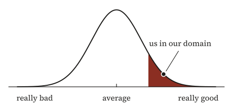
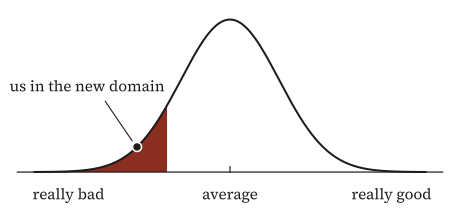

*There are so many things I’ve wanted to do. Yet, I’ve only ever done the things I was fairly certain I could achieve.*

In order to be good at something, you must be bad at it first. But that hurts. At least it hurt me when I sat down to write for the first time and my mind went blank. I constantly have all these thoughts and ideas in my head. Yet, when it came to formulating them on paper, nothing happened. I did what I used to do before – planned my time ahead in blocks in an attempt to create a routine that maximises productivity and allows for the pursuit of several goals at once. But creativity cannot be forced or scheduled. What came instead was the urge to quit and avoid the pain of being bad.

The older we get, the more we stop trying new things and keep to what we know. And that's built into the plan. We start wide at school, narrow down at university and then even more at work. And whether in the same field or not, we once again start doing the same thing or similar, day in and day out. We spend the better part of our hours awake doing that thing. In fact, we even start dedicating our free time to the same thing, so we can become better and progress faster. As if it's a race. And every time an opportunity to do something different comes up, we are either busy or tired. Maybe once in a while, we do say ‘Yes’. We do something else for a bit. Maybe we enjoy it. But even if we do, we start to question whether the time was well spent when we could have done our thing. After all, the new thing likely wasn't particularly productive, seeing as we were new to it. We optimise for time and measure every hour by its return. And a beginner’s hour always returns the least.

Another reason for our reluctance, I think, is our habit of comparing. We cannot help but compare ourselves to other people. And by becoming really good at something, we are better than most people at that exact thing. In statistics, we call that being in the ‘right tail’. If all people were plotted on a graph, according to their abilities in some domain, it would roughly look like this:

When we choose to specialise in a certain domain, by design we move towards the right tail. We eventually know more about it than most people in our comparison group. And that is a good feeling. Relative to others, we are doing very well in that specific area. Then, when we try a new thing, different and unrelated to our existing skills, it's very likely we will start somewhere in the left tail.

And that is uncomfortable, painful even. We are bad at something and we worry what people will say when they see us. We fear being embarrassed or laughed at. Even if we ignore the external, the internal situation is often as pessimistic. We do not enjoy being worse than average, or even average, at something when we are used to being very good at something else. Furthermore, we make the mistake of choosing the wrong comparison group. We tend to compare ourselves to people who are in the right tail of that domain, disregarding the fact that this, in all likelihood, took them much longer than we would guess. We go for a run, then see someone on social media who did twice the distance in less time. We set a new record at the gym, then see someone warm up with the same weight. It's easy to get discouraged.

I write all this, yet struggle to internalise it myself. In my adult life so far, I have mostly, if not exclusively, pursued things I was fairly certain I could achieve. I reached the right tail in one domain, finance, and did my best to solidify my place there. Three years of studying, working full-time and doing extra things on top – articles, certificates, and summer courses. Little time for other things, because it was always safer to do what I know. To go deeper, not wider. And somewhere along the way, satisfaction disappeared. The moment I finished my MBA and the extra stuff dried out, a restlessness appeared instead of the expected relief. For the first time in my life I had no commitments other than work, yet all I could think about was the other things I wanted to do but never had the courage to do so – writing, creating content, and trying out another way of life. And with the lack of intensity to keep me distracted, that feeling grew stronger and stronger. I thought about suppressing that urge, or trying to do so. But I could also picture how torturous staying would become, as I would start looking down on myself for not having the courage to try. So that wasn't an option anymore. I had to try to achieve something in a completely different area to finance, in the hope of earning a living that way.

For the first time in a while, the odds are not in my favour. Failure to turn this into a commercially viable endeavour, in the six months I have given myself, is the more likely outcome. But the way I see it, failure has a capped downside while regret doesn’t.

I have no idea what will happen. Will I fall back in love with finance? Will I miss home more than I thought? Will I enjoy this way of life? In six months, I will have an answer. But not today.
